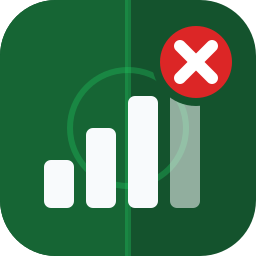

<p align="center">
  
</p>

<h1 align="center">efootball-monitor</h1>

**Never trust the bars.**

*[English version](README.md)*

Le jeu affiche 5 barres, et pourtant tes passes partent avec une demi-seconde de retard. Cet outil regarde le trafic
réseau d'eFootball pour te montrer ce qui se passe vraiment : sur quel serveur tu joues (ou contre quel adversaire, en
peer-to-peer), la latence et la perte de paquets, pendant tout le match.

## Pourquoi

Les barres donnent une vague idée, une seule fois, quand le match est trouvé. Elles ne disent pas où est le serveur,
si tu es en peer-to-peer, ni ce qui se passe après le coup d'envoi. Avec le monitor, tu as tout ça :

| | Barres du jeu | efootball-monitor |
|---|---|---|
| Localisation serveur / adversaire | non | fournisseur cloud + région, ou pays/ville |
| Client-server ou peer-to-peer | non | oui |
| Latence en ms | non | au début du match, puis chaque seconde |
| Perte de paquets | non | oui, avec un message quand elle bouge |
| Pendant le match | non | oui, jusqu'à la fin |
| Historique | non | `matchlogs.csv` |

## Ce que ça fait

- Détecte chaque match et indique s'il est en client-server (via un relais Konami) ou en peer-to-peer.
- Affiche la région cloud du serveur (Google Cloud ou AWS, ex. `asia-northeast1`, `eu-west-3`), ou le pays et la
  ville de l'adversaire si tu ajoutes la base IP2Location.
- Mesure le temps de réponse du serveur au début du match à partir de l'échange de connexion du jeu, puis la latence
  chaque seconde sous forme de points colorés.
- Calcule la perte de paquets (serveur/adversaire vers toi) et affiche une ligne quand elle varie de plus de 4 points.
- Bip quand un match est trouvé, la fenêtre peut rester réduite.
- Décode le test de vitesse que le jeu lance avant le matchmaking : latence et pertes vers chaque serveur Konami
  testé (commande `sp`).
- Enregistre chaque match dans `matchlogs.csv` (durée, serveur, latence, pire perte). Au bout de quelques soirées, tu
  vois quels serveurs et quels horaires te réussissent.
- Peut écrire l'état en direct dans un fichier texte pour un overlay OBS.
- Peut enregistrer une session en `.pcap`, la rejouer, et l'anonymiser avant de la partager.

L'outil lit seulement une copie du trafic, comme Wireshark. Il ne bloque, ne retarde et ne modifie aucun paquet, et ne
touche ni aux fichiers ni à la mémoire du jeu. Marche sous Windows, Linux et macOS, et avec PlayStation/Xbox si ton
routeur ou switch sait faire du port mirroring.

## Exemple

```text
21:04:12   1    client-server (Google Cloud asia-northeast1) match from  Japan-Tokyo-Tokyo
                local 192.168.1.20:52114  Remote 34.84.43.65:30123
  38ms 41 39 40 40 42.......o..   41
21:07:55 fluctuation: 12.5% loss
...
UTC 2026/11/09 20:13:40 Client-server match ended, cancelled or switched to TCP
summary:  elapse 09:28 latency: initial/avg/min/max 38/41/38/97   Max loss rate: 12.5%
```

(Valeurs inventées. Dans le terminal, les points sont colorés selon la latence.)

## Démarrage rapide (Windows)

1. Installe [Npcap](https://npcap.com/#download) avec les options par défaut.
2. Récupère `efootball-monitor-windows-x64.zip` dans [Releases](../../releases) et extrais-le.
3. Lance `efootball-monitor.exe`, choisis ta carte réseau, lance eFootball.

Pour avoir les villes des serveurs et des adversaires, ajoute les fichiers gratuits IP2Location (voir
[Installation](#installation)).

Projet communautaire, sans lien avec Konami.

## Prérequis

- **Windows 10/11** : [Npcap](https://npcap.com/#download) (gratuit, du projet Nmap), options par défaut.
- **Linux** : `libpcap`, en général déjà installé. Lancer avec `sudo`, ou une fois pour toutes :
  `sudo setcap cap_net_raw,cap_net_admin+eip ./efootball-monitor`
- **macOS** : rien à installer. Lancer avec `sudo`.

Sur PC, lance-le sur la machine où tourne le jeu. L'Ethernet c'est mieux, mais le Wi-Fi marche en général.

Sur PlayStation / Xbox, le PC doit voir le trafic de la console. Il faut un routeur ou un switch avec port mirroring
(recopie du port de la console vers celui du PC). Les consoles du réseau local sont reconnues automatiquement.

Les VPN marchent s'ils créent une carte réseau normale ou « RAW IP » (c'est le cas de WireGuard). En gros : si
Wireshark voit le trafic du jeu sur cette carte, l'outil aussi.

## Installation

1. Windows uniquement : installe [Npcap](https://npcap.com/#download).
2. Télécharge l'archive pour ton système dans [Releases](../../releases) et extrais-la quelque part.
3. Optionnel : la base gratuite IP2Location LITE DB3, pour les villes.
   - Crée un compte gratuit sur <https://lite.ip2location.com>.
   - Télécharge DB3 LITE BIN pour l'IPv4 (`IP2LOCATION-LITE-DB3.BIN`), et l'IPv6 si tu veux
     (`IP2LOCATION-LITE-DB3.IPV6.BIN`).
   - Mets les fichiers `.BIN` à côté du programme.

   Sans ces fichiers, les serveurs Konami affichent quand même leur région cloud (`Google Cloud asia-northeast1`,
   `AWS eu-west-3`...), mais les adversaires en peer-to-peer apparaissent en `unknown`.

## Utilisation

Lance le programme, choisis ta carte réseau, puis joue normalement. Laisse la fenêtre ouverte (réduite, ça va).

```text
efootball-monitor              # demande quelle carte utiliser
efootball-monitor 2            # utilise la carte 2
efootball-monitor --list       # affiche juste la liste des cartes
```

Pendant que ça tourne, tu peux taper :

- `sp` + Entrée : détail du test de vitesse (latence min/max/moy et pertes par serveur Konami)
- `hh` + Entrée : serveurs de test trouvés jusqu'ici

Options :

| Option | Défaut | |
|---|---|---|
| `[NUMÉRO]` | demandé | carte réseau |
| `--geo-dir <DOSSIER>` | dossier du programme | où sont les fichiers `.BIN` IP2Location |
| `--match-log <FICHIER>` | `matchlogs.csv` | historique des matchs |
| `--speed-servers <FICHIER>` | `speedtest.txt` | serveurs du test de vitesse (mis à jour tout seul) |
| `--overlay-file <FICHIER>` | désactivé | écrit l'état en direct dans un fichier texte (source texte OBS etc.) |
| `--record <FICHIER>` | désactivé | enregistre aussi le trafic du jeu dans un `.pcap` |

## Lire l'affichage

Au début d'un match : l'heure, le numéro du match, le mode, le fournisseur/la localisation du serveur, et les adresses
locale et distante. En client-server, le nombre jaune est le temps de réponse du serveur au début du match.

Pendant un match client-server, le serveur est sondé chaque seconde (connexion TCP, ou ping pour les serveurs sur le
port 5735). Les cinq premières valeurs s'affichent en chiffres, ensuite un caractère par seconde :

| Caractère | Latence |
|---|---|
| `.` blanc | < 15 ms |
| `.` vert | < 30 ms |
| `.` jaune | < 50 ms |
| `.` bleu | < 75 ms |
| `.` magenta | < 100 ms |
| `o` cyan | < 125 ms |
| `O` bleu | < 150 ms |
| `P` magenta | < 200 ms |
| `Q` rouge | < 250 ms |
| `R` rouge | < 400 ms |
| `X` rouge | 400 ms ou plus, ou pas de réponse |

En peer-to-peer, la latence vient des messages keep-alive que le jeu échange avec l'adversaire.

`fluctuation: x% loss` apparaît quand la perte varie de plus de 4 points. Le jeu envoie ses données par groupes de 256
messages, donc la perte est comptée par groupe, dans le sens serveur/adversaire → toi.

Un match est considéré comme terminé après 8 s sans trafic (client-server) ou 3 s (peer-to-peer). Si un match
client-server « se termine » juste après avoir commencé, le jeu est sans doute passé en TCP, que l'outil ne voit pas.

Avant le matchmaking, le jeu ping plein de serveurs Konami. Quelques secondes après, un petit résumé s'affiche
(`région [min/moy ms] réponses/envois`). `sp` donne le tableau complet.

### matchlogs.csv

Une ligne par match de plus de 90 s :

`MatchTime, IP, Port, Region, MatchMode, Provider, MatchDuration, InitialDelay(ms), MinDelay(ms), AvgDelay(ms), MaxDelay(ms), MaxLossRate`

## Enregistrer et partager une session

```text
efootball-monitor --record session.pcap                    # joue normalement, le trafic est enregistré
efootball-monitor replay session.pcap                       # rejoue la session, instantanément
efootball-monitor replay session.pcap --realtime            # rejoue à la vitesse d'origine
efootball-monitor anonymize session.pcap session-anon.pcap  # nettoie avant de partager
```

Les captures Wireshark (`.pcap`, `.pcapng`) marchent aussi. `replay` n'a pas besoin de Npcap, ne contacte aucun
serveur (pas de mesure de latence) et ne touche ni à `matchlogs.csv` ni à `speedtest.txt`.

Les captures aident vraiment : une mise à jour du jeu peut changer les messages réseau, et seul du vrai trafic permet
de vérifier que la détection marche encore. Lance `anonymize` avant. Ça remplace ton IP, celles des autres joueurs et
les adresses MAC, et ça vire tout ce qui n'est pas du trafic de jeu (DNS etc.). Les adresses des serveurs Konami sont
gardées. Les paquets du jeu eux-mêmes ne sont pas modifiés, donc ne partage que ce que tu veux bien partager.

Pour signaler un problème, ouvre une issue avec le modèle *Detection problem* et joins le fichier anonymisé.
[fixtures/README.md](fixtures/README.md) (en anglais) explique comment en faire un test de non-régression.

## Dépannage

**`Npcap is not installed`** : installe-le depuis <https://npcap.com/#download> et relance le programme.

**`No network interfaces found`** : sous Windows, réinstalle Npcap. Si tu as coché « Restrict Npcap driver's access to
Administrators only », lance en administrateur. Sous Linux/macOS, utilise `sudo`.

**Rien ne s'affiche quand un match est trouvé** : sûrement la mauvaise carte réseau, essaie un autre numéro. Ça peut
aussi être un match en TCP, ou le port mirroring pas configuré (consoles).

**La latence est toujours `X`** : le serveur ne répond pas aux sondes depuis ton réseau (pare-feu, box). Les serveurs
sur le port 5735 utilisent le ping, qui demande les droits admin sous Windows. Les matchs et la perte de paquets sont
quand même détectés.

**Les localisations affichent `unknown`** : mets les fichiers `.BIN` IP2Location à côté du programme, ou utilise
`--geo-dir`.

**Mauvais mode, match raté, chiffres bizarres** : enregistre avec `--record`, anonymise, ouvre une issue.

## Compiler

Il faut [Rust](https://rustup.rs) 1.84+.

```sh
cargo build --release
cargo test               # tests unitaires + replay de chaque capture de fixtures/
```

Sous Linux, installe `libpcap-dev` avant. Sous Windows, récupère le [Npcap SDK](https://npcap.com/#download) puis
`set LIBPCAP_LIBDIR=C:\chemin\vers\npcap-sdk\Lib\x64`.

Comment les matchs sont détectés : [docs/PROTOCOL.md](docs/PROTOCOL.md) (en anglais).
Mettre à jour les listes d'IP cloud : `python3 tools/update_cloud_ranges.py`.

## Crédits

- Basé sur l'idée de l'outil *eFootball Network Monitor* de la chaîne eFootballCheaterReport. Ce projet en est une
  implémentation open source séparée.
- Peut utiliser les données IP2Location LITE de <https://lite.ip2location.com> (CC BY-SA 4.0). Non incluses.
- Plages d'IP cloud publiées par [Google Cloud](https://www.gstatic.com/ipranges/cloud.json) et
  [AWS](https://ip-ranges.amazonaws.com/ip-ranges.json).
- eFootball est une marque de Konami Digital Entertainment.

Licence : [MIT](LICENSE-MIT) ou [Apache-2.0](LICENSE-APACHE), au choix.
