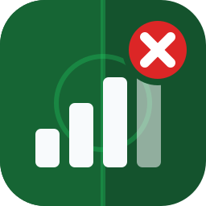

<p align="center">
  
</p>

<h1 align="center">efootball-monitor</h1>

**Never trust the bars.**

*[Version française](README.fr.md)*

eFootball shows you five bars, and then your passes arrive half a second late. This tool watches the game's network
traffic so you can see what is actually going on: which server you got (or which opponent, in peer-to-peer), the
latency, and the packet loss, for the whole match.

Best part: you see all that **before you accept the match**. Too far, too laggy? Decline it and pick your next one.

## Why

The bars only give you a rough idea, once, when the match is found. They don't say where the server is, whether
you're in peer-to-peer, or what happens after kick-off. Here's what you get with the monitor instead:

| | In-game bars | efootball-monitor |
|---|---|---|
| Server / opponent location | no | cloud provider + region, or country/city |
| Client-server or peer-to-peer | no | yes |
| Know before accepting a match | no | location + latency on the accept screen |
| Latency in ms | no | at match start, then every second |
| Packet loss | no | yes, with a warning when it jumps |
| During the match | no | yes, until the end |
| History | no | `matchlogs.csv` |

## Accept or decline?

When the game finds an opponent, you get a few seconds to accept or decline. The monitor beeps at that point and
shows where the match goes and the latency. Server in Tokyo at 180 ms while you're in Paris? Decline in the game and
search again.

With `--overlay` (Windows), a small window stays on top of the game with just what you need:

```text
CLIENT-SERVER  ·  Google Cloud asia-northeast1
Tokyo, Japan
182 ms    0.0% loss
```

The tool never accepts or declines anything itself, you decide in the game.

## What it does

- Detects each match and tells you if it's client-server (through a Konami relay) or peer-to-peer.
- Shows where the server is (e.g. `Tokyo, Japan`, `Johannesburg, South Africa`, from its Google Cloud or AWS region),
  or the opponent's country and city if you add the IP2Location database.
- Measures the server's response time at match start from the game's own handshake, then the latency every second
  as a small live graph, with a GOOD / OK / FAR hint to help you accept or decline.
- Computes packet loss (server/opponent to you) and prints a line when it moves by more than 4 points.
- Beeps when a match is found, so you can leave the window minimized.
- Decodes the speed test the game runs before matchmaking: latency and loss to each Konami server it pings
  (`speed` command).
- Logs every match to `matchlogs.csv` (duration, server, latency, worst loss). After a few evenings you can see which
  servers and times work for you.
- Small always-on-top window with the current match (`--overlay`, Windows), or a text file for an OBS overlay.
- Can record a session to `.pcap`, replay it later, and anonymize it before sharing.

It only reads a copy of the traffic, like Wireshark does. It doesn't block, delay or change any packet, and doesn't
touch the game's files or memory. Works on Windows, Linux and macOS, and with PlayStation/Xbox if your router or
switch can mirror the console's port.

## Example

```text
── Match 3 - 21:04:12 ──────────────────────────────────────
  Client-server - Tokyo, Japan (Google Cloud asia-northeast1)
  Ping 182 ms   FAR - consider declining

── Match 4 - 21:05:40 ──────────────────────────────────────
  Client-server - Paris, France (AWS eu-west-3)
  Ping 38 ms   GOOD
  21:05  ping avg 41 ms (38-52), loss 0.0%
  21:06  ping avg 44 ms (38-97), loss 0.0%
  ! 21:07:12 ping spike 212 ms
  ! 21:07:55 packet loss 12.5% (was 0.0%)
  21:07  ping avg 52 ms (39-212), loss 12.5%
  ...
  ping ▁▁▂▁▁▁▃▁▁▂▁▁▁▅▁▁▁▂▁▁ 41 ms  min 38 avg 42 max 97  loss 0.0%  09:28
  Match over - 9 min 28 s - ping avg 41 ms (min 38, max 97) - worst loss 12.5%
```

(Made-up values. In the terminal, ping values and bars are colored: green, yellow, orange, red.)

## Quick start (Windows)

1. Install [Npcap](https://npcap.com/#download) with the default options.
2. Get `efootball-monitor-windows-x64.zip` from [Releases](../../releases) and extract it.
3. Run `efootball-monitor.exe`, pick your network card, start eFootball.

For the on-top window, start it with `efootball-monitor.exe --overlay` (or add `--overlay` at the end of a
shortcut's target). The game has to be in windowed or borderless mode: Windows doesn't draw anything over exclusive
fullscreen.

To see where peer-to-peer opponents are, add the free IP2Location files (see [Installation](#installation)).

This is a community project. It is not affiliated with or endorsed by Konami.

## Requirements

- **Windows 10/11**: [Npcap](https://npcap.com/#download) (free, from the Nmap project), default options.
- **Linux**: `libpcap`, usually already there. Run with `sudo`, or once:
  `sudo setcap cap_net_raw,cap_net_admin+eip ./efootball-monitor`
- **macOS**: nothing to install. Run with `sudo`.

On PC, run it on the machine where the game runs. Ethernet is better but Wi-Fi usually works.

On PlayStation / Xbox, the PC has to see the console's traffic. You need a router or switch with port mirroring
(copy the console's port to the PC's port). Consoles on the local network are picked up automatically.

VPNs work if they create a normal or "RAW IP" adapter (WireGuard does). Rule of thumb: if Wireshark sees the game
traffic on that adapter, so will this.

## Installation

1. Windows only: install [Npcap](https://npcap.com/#download).
2. Download the archive for your system from [Releases](../../releases) and extract it somewhere.
3. Optional: the free IP2Location LITE DB3 database, to locate peer-to-peer opponents.
   - Make a free account on <https://lite.ip2location.com>.
   - Download DB3 LITE BIN for IPv4 (`IP2LOCATION-LITE-DB3.BIN`), and the IPv6 one if you want
     (`IP2LOCATION-LITE-DB3.IPV6.BIN`).
   - Put the `.BIN` files next to the program.

   Without them, Konami servers still show their city and country (`Tokyo, Japan`, `Paris, France`...), but
   peer-to-peer opponents show up as `unknown`.

## Usage

Start the program, choose your network interface, then play as usual. Leave the window open (minimized is fine).

```text
efootball-monitor              # asks which interface to use
efootball-monitor 2            # use interface 2
efootball-monitor --list       # just list the interfaces
```

While it runs you can type:

- `speed` + Enter: speed test details (min/avg/max latency and loss per Konami server)
- `servers` + Enter: speed test servers found so far, with their addresses
- `help` + Enter: commands and colors

Options:

| Option | Default | |
|---|---|---|
| `[NUMBER]` | asks | network interface |
| `--geo-dir <DIR>` | program folder | where the IP2Location `.BIN` files are |
| `--match-log <FILE>` | `matchlogs.csv` | match history |
| `--speed-servers <FILE>` | `speedtest.txt` | speed test servers (updated automatically) |
| `--overlay` | off | small always-on-top window with the current match (Windows). Drag it to move it, right-click to hide it until the next match |
| `--overlay-file <FILE>` | off | write the live status to a text file (OBS text source etc.) |
| `--record <FILE>` | off | also save the game traffic to a `.pcap` |
| `--max-ping <MS>` | `120` | matches at or above this ping are flagged `FAR` |
| `--show-ip` | off | show IP addresses and ports (hidden by default) |
| `--ascii` | off | plain characters, if the ping graph shows up as boxes in an old console |

## Reading the output

**When a match is found** you get a block with the match number and time, the mode (client-server or
peer-to-peer), where it goes, and the ping measured by the game itself at the start of the match, with a hint:

- `GOOD`: under 60 ms
- `OK`: between 60 ms and the `--max-ping` limit (120 ms by default)
- `FAR - consider declining`: at or above the limit

**During the match**, one line is updated every second: a small graph of the last 30 seconds (one bar per second,
taller = slower), the current ping, the exact min / average / max over those 30 seconds, the packet loss and the
match time. Colors: green under 50 ms, yellow under 100 ms, orange under 200 ms, red above or no answer.

Above it, a line stays in the history every minute with the exact figures of that minute
(`21:06  ping avg 44 ms (38-97), loss 0.0%`), so you can scroll back through the whole match. Each time the ping
goes over `--max-ping`, `! ping spike 212 ms` is printed with the time.

In client-server, the live ping comes from our own probes to the server (TCP connect, or ping for servers on port
5735), so it can differ a bit from the game's own measurement in the header. In peer-to-peer, it comes from the
keep-alive messages the game exchanges with the opponent.

**`! packet loss x% (was y%)`** shows up when loss changes by more than 4 points. The game sends data in groups of 256
messages, so loss is counted per group, in the server/opponent → you direction.

**End of match**: after 8 s without traffic (client-server) or 3 s (peer-to-peer) you get a one-line summary. A
match that ends within 20 s was most likely declined or cancelled. In client-server it can also mean the game switched
to TCP, which the tool can't see.

**Speed test**: before matchmaking the game pings a bunch of Konami servers. A few seconds after that, a table shows
the average ping to each one. `speed` gives the full table.

IP addresses are hidden by default (handy when streaming). Use `--show-ip` to see them.

### matchlogs.csv

One line per match longer than 90 s:

`MatchTime, IP, Port, Region, MatchMode, Provider, MatchDuration, InitialDelay(ms), MinDelay(ms), AvgDelay(ms), MaxDelay(ms), MaxLossRate`

## Recording and sharing a session

```text
efootball-monitor --record session.pcap                    # play normally, traffic is saved
efootball-monitor replay session.pcap                       # replay it, instantly
efootball-monitor replay session.pcap --realtime            # replay at the original speed
efootball-monitor replay session.pcap --realtime --overlay  # same, with the overlay window
efootball-monitor anonymize session.pcap session-anon.pcap  # clean it up before sharing
```

Wireshark captures (`.pcap`, `.pcapng`) work too. `replay` doesn't need Npcap, doesn't contact any server (latency
probes are skipped) and doesn't touch `matchlogs.csv` or `speedtest.txt`.

Captures are really useful: game updates can change the network messages, and real traffic is the only way to check
the detection still works. Run `anonymize` first. It replaces your IP, other players' IPs and MAC addresses, and drops
everything that isn't game traffic (DNS etc.). Konami server addresses are kept. The game packets themselves are left
as they are, so only share what you're fine sharing.

To report a problem, open an issue with the *Detection problem* template and attach the anonymized file.
[fixtures/README.md](fixtures/README.md) explains how to turn a capture into a regression test.

## Troubleshooting

**`Npcap is not installed`**: install it from <https://npcap.com/#download> and restart the program.

**`No network interfaces found`**: on Windows, reinstall Npcap. If you checked "Restrict Npcap driver's access to
Administrators only", run as administrator. On Linux/macOS, use `sudo`.

**Nothing happens when a match is found**: probably the wrong interface, try another number. It can also be a TCP
match, or port mirroring not set up (consoles).

**Latency is always `X`**: the server doesn't answer probes from your network (firewall, router). Servers on port
5735 use ping, which needs admin rights on Windows. Matches and packet loss are still detected.

**Locations show `unknown`**: put the IP2Location `.BIN` files next to the program, or use `--geo-dir`.

**Wrong mode, missed match, weird numbers**: record with `--record`, anonymize, open an issue.

## Building

Needs [Rust](https://rustup.rs) 1.84+.

```sh
cargo build --release
cargo test               # unit tests + replays every capture in fixtures/
```

On Linux install `libpcap-dev` first. On Windows, get the [Npcap SDK](https://npcap.com/#download) and
`set LIBPCAP_LIBDIR=C:\path\to\npcap-sdk\Lib\x64`.

How matches are detected: [docs/PROTOCOL.md](docs/PROTOCOL.md).
Refreshing the cloud IP lists: `python3 tools/update_cloud_ranges.py`.

## Credits

- Based on the idea of the *eFootball Network Monitor* tool from the eFootballCheaterReport channel. This is a
  separate open-source implementation.
- Can use IP2Location LITE data from <https://lite.ip2location.com> (CC BY-SA 4.0). Not included.
- Cloud IP ranges published by [Google Cloud](https://www.gstatic.com/ipranges/cloud.json) and
  [AWS](https://ip-ranges.amazonaws.com/ip-ranges.json).
- eFootball is a trademark of Konami Digital Entertainment.

License: [MIT](LICENSE-MIT) or [Apache-2.0](LICENSE-APACHE), your choice.
